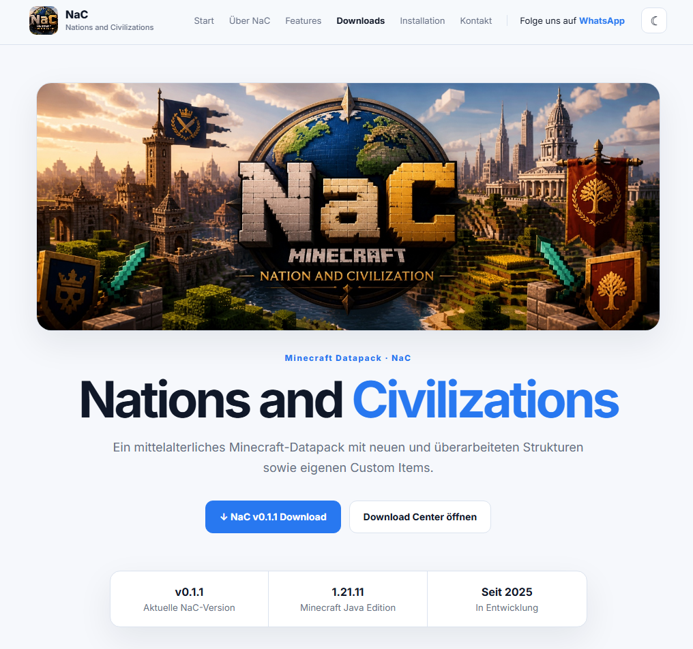
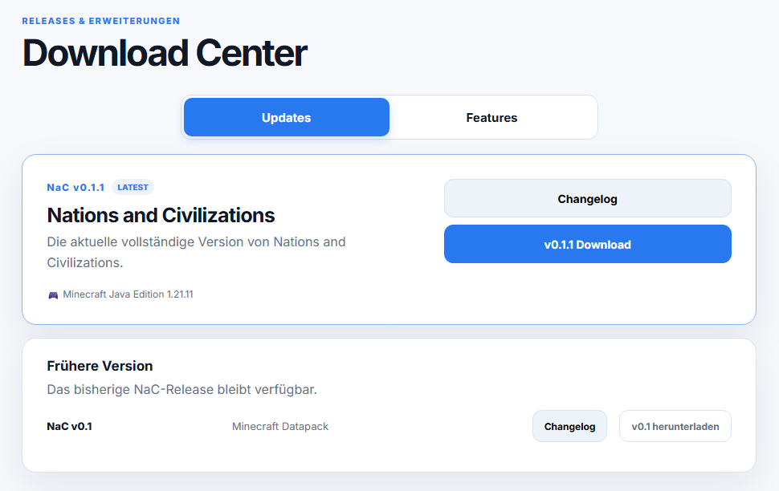
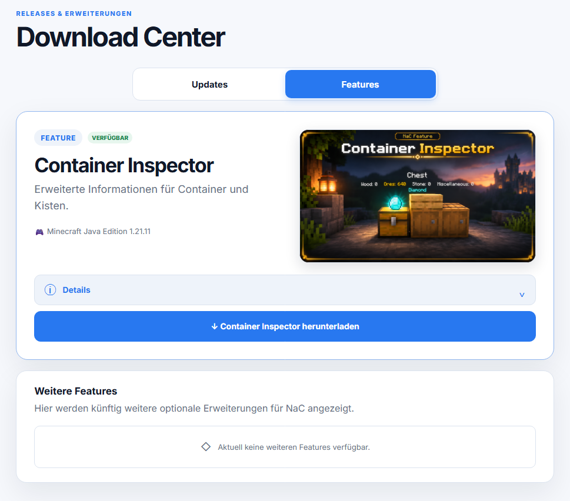

# 🏰 NaC Mod Launcher

Eine Website für Nations and Civilizations (NaC), die zentrale Plattform für Downloads, Updates und Erweiterungen des Minecraft-Datapacks.

🌐 **Website:** [NaC öffnen](https://nac-datapack.pages.dev/)

---

## 📸 Website-Einblicke

### Startseite

  

### Download Center – Updates

  

### Download Center – Features

  

---

## ✨ Funktionen

- 📦 Zentrale Übersicht über verfügbare NaC-Inhalte und Downloads
- 🧩 Zusätzliche Erweiterungen und Features entdecken und herunterladen
- ⬇️ Benötigte Dateien direkt herunterladen
- 📖 Installationsanleitungen für Updates und Erweiterungen

---

## 🛠️ Technologien

---

## 📦 Entwicklungsstand

**Aktuelle NaC-Version:** 0.1.1

**Kompatibilität:** Minecraft Java Edition 1.21.11

Die Website wird kontinuierlich weiterentwickelt und um neue Downloadmöglichkeiten und Erweiterungen ergänzt.

---

## 🔮 Zukunft

Das Download-Center soll zukünftig um weitere NaC-Inhalte, Updates und optionale Erweiterungen ergänzt werden.

---

## 👨‍💻 Entwickler

**Jonathan**
