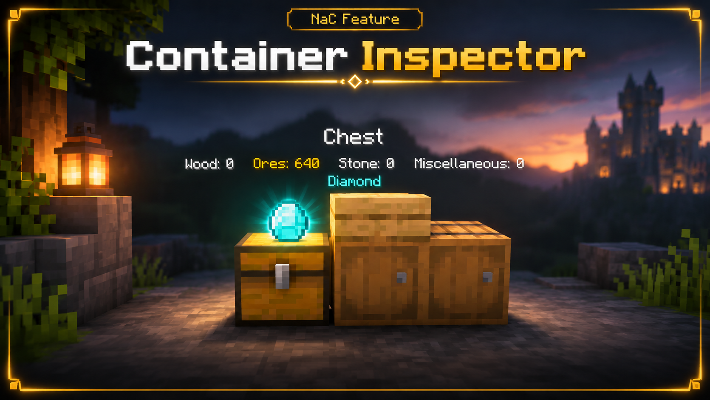

# 🏰 NaC Mod Launcher

Eine Website für das Minecraft-Datapack **Nations and Civilizations (NaC)** mit Download-Center für vollständige Updates und optionale Erweiterungen.

🌐 **Website:** [NaC öffnen](https://nac-datapack.pages.dev/)

📥 **Download Center:** [Downloads öffnen](https://nac-datapack.pages.dev/#download)

---

## 📸 Einblicke

### NaC – Nations and Civilizations

  

### Container Inspector

  

---

## ✨ Funktionen

- 📦 Download-Center für NaC-Updates und optionale Features
- ⬇️ Download vollständiger Datapack- und Resourcepack-Pakete
- 🧩 Einzelne Erweiterungen unabhängig herunterladen
- 📋 Changelogs für veröffentlichte Versionen
- 📖 Installationsanleitungen für Updates und Features
- 🌙 Hell- und Dunkelmodus
- 💬 Verlinkung zum NaC-WhatsApp-Kanal

---

## 📦 Verfügbare Inhalte

| Inhalt | Beschreibung |
|---|---|
| NaC v0.1.1 | Aktuelle vollständige Version |
| NaC v0.1 | Frühere Version |
| Container Inspector v0.1.0 | Optionale Erweiterung für zusätzliche Informationen zu Containern und Kisten |

**Kompatibilität:** Minecraft Java Edition 1.21.11

---

## 🛠️ Technologien

---

## 📦 Entwicklungsstand

**Aktuelle NaC-Version: 0.1.1**

**Minecraft Java Edition: 1.21.11**

Die Website und das Datapack werden kontinuierlich weiterentwickelt.

---

## 🔮 Zukunft

NaC wird kontinuierlich weiterentwickelt. Weitere Updates, neue Inhalte und optionale Features sollen zukünftig über das Download-Center verfügbar gemacht werden.

---

## 👨‍💻 Entwickler

**Jonathan** · [GitHub](https://github.com/jonyxjr)
